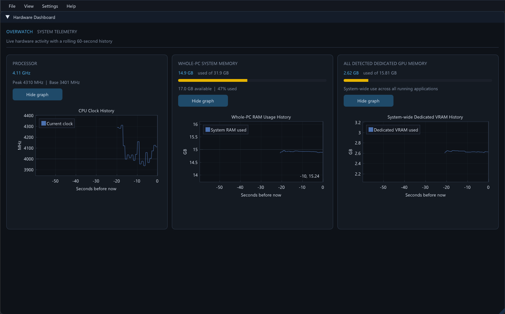

# Overwatch System Monitor

A lightweight Windows desktop dashboard for watching CPU clock speed, system RAM, and dedicated GPU memory in real time.




## Features

- Live CPU clock, base clock, and session peak clock.
- Whole-PC physical memory usage, available RAM, and usage percentage.
- System-wide dedicated GPU memory usage across detected adapters.
- Optional live graphs with a rolling 60-second history.
- Responsive dashboard layout with dark and light themes.
- Remembers dashboard size and position between launches.

GPU memory monitoring uses Windows performance counters. GPU readings may be unavailable on systems where the **GPU Adapter Memory** counters are missing.

## Requirements

- Windows 10 or later.
- [MSYS2](https://www.msys2.org/) with the **UCRT64** environment.
- GCC, GNU Make, and the GLFW development package.

The Dear ImGui and ImPlot source files are included in this repository. GLFW runtime DLLs are included alongside the project.

## Build and run

Open an **MSYS2 UCRT64** terminal, then install the build tools and GLFW if needed:

```sh
pacman -S --needed mingw-w64-ucrt-x86_64-gcc mingw-w64-ucrt-x86_64-make mingw-w64-ucrt-x86_64-glfw
```

Clone the repository and build/run the dashboard:

```sh
git clone https://github.com/Noahh101/Overwatch.git
cd Overwatch
make run
```

`make run` builds the executable if needed and then launches it. To build without launching:

```sh
make
```

To remove the executable and generated build files:

```sh
make clean
```

## Controls

- Use **View** to show or hide monitor cards.
- Use each card's **Show graph / Hide graph** button to toggle its graph.
- Use **Settings** to switch between dark and light themes or change VSync.

## Built with

- C++ and the Windows APIs (DXGI, PDH, and system memory APIs)
- [Dear ImGui](https://github.com/ocornut/imgui)
- [ImPlot](https://github.com/epezent/implot)
- [GLFW](https://www.glfw.org/)
